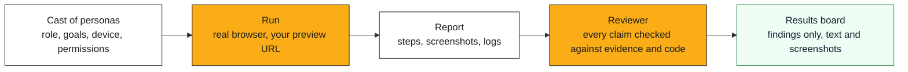

  <strong>Dummy Run</strong> 
  Fictional users, played by AI, try to do their real job in your app before your customers do. 
  Every finding comes with the evidence.

> **Status: pre-release.** Dummy Run is being extracted from a private deployment where it has run
> several hundred reviewed sessions against pull-request preview environments and found permission
> leaks, crashes and accessibility blockers that automated tests had missed. The engine, reviewer
> and results board land here over the coming weeks. Nothing in this repository is ready to install yet.

## In thirty seconds

A **persona** is a fictional user with a role, goals, habits, a device and a set of permissions. A **run**
puts that persona in a real browser (Chrome or Firefox, over WebDriver BiDi), signs it in to your app,
usually a per-pull-request preview environment, and asks it to do its job. It reports what broke, what
confused it, and what it could see that it should not have been able to see. A **reviewer** then checks
every claim against the screenshots, the logs and the code, and only the claims the evidence supports
reach the **results board**.

Dummy Run is a crash test for software: the dummies take the hit so your users do not, and every impact
is on film.

## Who it is for

| You are | You get |
|---|---|
| A QA lead | Exploratory, role-aware testing on every PR, with reproducible evidence and no scripts to maintain |
| A solo developer | A second pair of eyes that uses the product like a customer, on your laptop or in CI |
| An agency | The same cast run against every client's preview, with per-market data residency |
| Product and UX | Friction and confusion reports in plain language, tied to the exact step and screenshot |
| Compliance and security | Permission-leak findings (what a role can see or do that it should not), verified before they are raised |
| An executive | A one-page board that says what is broken, for whom, and how we know |

## How it works

- **Pluggable targets.** A target adapter knows how to find the preview for a pull request, provision a
  test user with a given role, and seed fixtures. The first adapter is the one from the private
  deployment; adapters for Vercel, Netlify, Cloudflare Pages and plain URLs follow.
- **Pluggable LLM providers.** Vertex AI, Azure AI Foundry, Anthropic and local models, chosen per market
  so that persona runs can be kept inside a jurisdiction (UK, EU, US).
- **Evidence or nothing.** A claim with no screenshot, log line or code reference behind it is dropped by
  the reviewer, not kept as a guess.
- **Nothing posted automatically.** Findings go to the board. A person decides what becomes a ticket.

## Roadmap

See [docs/PLAN.md](docs/PLAN.md). In short: extract the engine with a clean history, ship a demo target
app and an example cast, publish the Helm chart and a docker-compose path, then the Azure and Google
Cloud adapters with an integration matrix across both.

## Documentation

| Document | What it covers |
|---|---|
| [docs/PLAN.md](docs/PLAN.md) | Extraction plan, release order, infrastructure direction |
| [docs/ARCHITECTURE.md](docs/ARCHITECTURE.md) | Adapters, the evidence pipeline, data residency |
| [docs/STYLE.md](docs/STYLE.md) | House style for writing, citations and the type scale |
| [docs/NAMING.md](docs/NAMING.md) | How the name was chosen, with the rubric and the sources |
| [docs/TYPOGRAPHY.md](docs/TYPOGRAPHY.md) | Minimum sizes and the fluid type scale for every surface |
| [docs/FREE-FOR-OSS.md](docs/FREE-FOR-OSS.md) | Services and programmes this project uses or plans to use |
| [CONTRIBUTING.md](CONTRIBUTING.md) | How to help, and the rules about evidence and privacy |
| [SECURITY.md](SECURITY.md) | Reporting a vulnerability in Dummy Run, and what to do with findings about other people's apps |

## Licence

Apache License 2.0. See [LICENSE](LICENSE).
