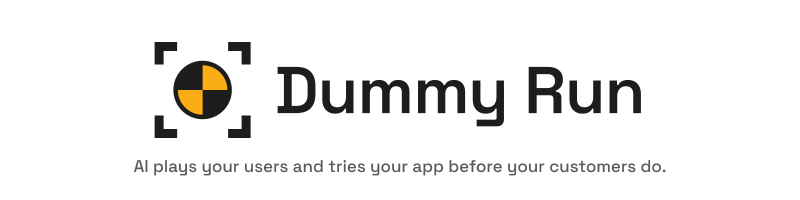
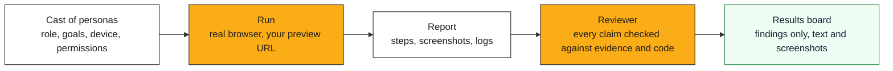

  <picture>
    <source media="(prefers-color-scheme: dark)" srcset="brand/logo/readme-header-dark.svg">
    
  </picture>

  
  
  
  
  

> Pre-release. Nothing here installs yet.

## How it works

A persona is a fictional user. It has a role with permissions, plus goals, habits and a device.

A run signs one persona in to your app in Chrome or Firefox. The app is usually a preview built for one
pull request. The persona tries to do its job and reports what broke, what confused it and what its role
should not have seen. A reviewer checks each claim against screenshots, logs and code. Only claims with
evidence reach the results board.

- **Targets.** An adapter finds the preview for a pull request, creates a test user with the right role
  and loads test data. Planned adapters cover plain URLs and GitHub Deployments, plus Vercel, Netlify
  and Cloudflare Pages.
- **Model providers.** Vertex AI, Azure AI Foundry, Anthropic or a local model. Choose one per market to
  keep runs inside a jurisdiction such as the UK or the EU.
- **Nothing is posted for you.** Findings go to the board. A person decides what becomes a ticket.

## Who it is for

| You are | What you get |
|---|---|
| A QA lead | Exploratory testing by role on every pull request, with no scripts to maintain |
| A developer | Your product used the way a customer uses it, on your laptop or in CI |
| An agency | One cast run against every client's preview, with each client's data kept in its market |
| Product and UX | Friction and confusion, each tied to the step and screenshot |
| Compliance and security | What each role can see or do beyond its rights, verified before it is raised |
| An executive | One board showing what is broken, who it affects and the evidence |

## Documentation

| Document | What it covers |
|---|---|
| [docs/PLAN.md](docs/PLAN.md) | What ships, in what order |
| [docs/ARCHITECTURE.md](docs/ARCHITECTURE.md) | Adapters, the evidence pipeline and data residency |
| [docs/TELEMETRY.md](docs/TELEMETRY.md) | How runs map to OpenTelemetry traces, metrics, logs and Grafana annotations |
| [schema/run-record.schema.json](schema/run-record.schema.json) | The format of a run record, with examples in [examples/runs/](examples/runs/) |
| [CONTRIBUTING.md](CONTRIBUTING.md) | How to contribute, the automated checks, and the rules on evidence and privacy |
| [SECURITY.md](SECURITY.md) | Reporting a vulnerability, and findings about apps you do not own |
| [docs/LICENSING.md](docs/LICENSING.md) | What the licence lets you do |
| [docs/STYLE.md](docs/STYLE.md), [docs/TYPOGRAPHY.md](docs/TYPOGRAPHY.md) | How we write and set type |
| [docs/NAMING.md](docs/NAMING.md) | How the name was chosen |
| [brand/README.md](brand/README.md) | The logo, mascot and colours |

## Licence

[Apache License 2.0](LICENSE). The name and logo are covered by the [trademark policy](TRADEMARKS.md).
