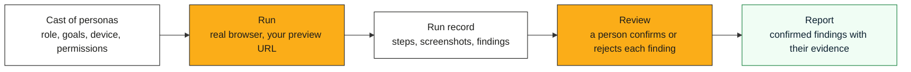

  <picture>
    <source media="(prefers-color-scheme: dark)" srcset="brand/logo/readme-header-dark.svg">
    
  </picture>

  
  
  
  
  

> Dummy Run is pre-release and has no tagged version yet. Install it with
> `go install github.com/dummy-run/dummy-run/cmd/dummyrun@latest`, then follow
> [docs/ENGINE.md](docs/ENGINE.md) to run your first persona. The website is [dummyrun.dev](https://dummyrun.dev).

## How it works

A persona is a made-up user. It has a role and permissions, plus goals, habits and a device. You point one at your
app, usually a preview built for a pull request, and it signs in and tries to get its job done in Chrome or
Firefox.

When it's finished, you get a run record. It holds every step with a screenshot, what broke, what
confused the persona and anything its role shouldn't have been able to see. You then go through the
findings with `dummyrun review` and confirm or reject each one. `dummyrun report` turns the confirmed
findings into a report you can share.

You tell the engine where your app lives with a small JSON target file: the base URL, the hosts it may
visit and how to sign in. Examples are in [examples/targets/](examples/targets/).

The persona runs on a model provider you choose. That can be Azure OpenAI, Anthropic or Amazon Bedrock.
It can also be Gemini, directly or on Vertex AI, or any OpenAI-compatible service such as a server on
your own machine. Pick a provider and region in the market
you need, such as the UK or the EU, and runs stay there. [docs/PROVIDERS.md](docs/PROVIDERS.md) covers each one.

Nothing turns into a ticket on its own. You decide what goes in your tracker, either by copying a finding
across or by scripting against the run record JSON.

## Does it replace a scripted regression suite?

No, keep your suite. A script checks the steps you wrote, the same way every time. A persona picks its own
actions as it goes, so it can find problems nobody thought to script. When it finds one you want guarded
for good, write a test for it.

## What leaves your network

The persona is a model reading what the browser shows, so screenshots and page text go to the model
provider you choose. Telemetry is optional and holds no screenshots. It carries step URLs, control labels
and finding titles, which can quote a few words from the page. It goes only to the OpenTelemetry
backend you configure. [docs/TELEMETRY.md](docs/TELEMETRY.md) lists every field.

## Who it's for

| You are | What you get |
|---|---|
| A QA lead | Exploratory testing by role on every pull request, with no scripts to maintain |
| A developer | Your product used the way a customer uses it, on your laptop or in CI |
| An agency | One cast run against every client's preview, with each client's data kept in its market |
| Product and UX | Friction and confusion, each tied to the step and screenshot |
| Compliance and security | What each role can see or do beyond its rights, checked by a person before it's raised |
| An executive | A report of what's broken, who it affects and the evidence |

## Documentation

| Document | What it covers |
|---|---|
| [docs/ENGINE.md](docs/ENGINE.md) | Install the engine, run a persona, review findings, sign in, the read-only policy and the accessibility sweep |
| [docs/MCP.md](docs/MCP.md) | Use Dummy Run from Claude Code, Cursor, VS Code or Codex through `dummyrun mcp` |
| [docs/CLI.md](docs/CLI.md) | Every command and flag, from the built-in help |
| [docs/PROVIDERS.md](docs/PROVIDERS.md) | The model providers, how to sign in to each and what each supports |
| [docs/PERSONAS.md](docs/PERSONAS.md) | Copy a persona from the [library](casts/library/README.md) into your cast and adapt it |
| [docs/COVERAGE.md](docs/COVERAGE.md) | What `dummyrun coverage` counts and how to read each number |
| [docs/REPORT.md](docs/REPORT.md) | What goes in a `dummyrun report` audit report and how to read a finding |
| [docs/BADGES.md](docs/BADGES.md) | The report badge and how to publish it from GitHub Actions |
| [docs/INKWELL.md](docs/INKWELL.md) | Inkwell, a small app with planted defects to try personas on |
| [docs/ARCHITECTURE.md](docs/ARCHITECTURE.md) | How a run is put together and where data lives |
| [docs/TELEMETRY.md](docs/TELEMETRY.md) | How runs map to OpenTelemetry traces, metrics, logs and Grafana annotations |
| [docs/integrations/grafana.md](docs/integrations/grafana.md) | Send runs to Grafana, link them to your app's traces and set up alerts |
| [docs/THREAT-MODEL.md](docs/THREAT-MODEL.md) | What a hostile page could try and what stops it |
| [docs/ETHICS.md](docs/ETHICS.md) | What a persona can and can't tell you |
| [schema/run-record.schema.json](schema/run-record.schema.json) | The run record format, with examples in [examples/runs/](examples/runs/) |
| [schema/report.schema.json](schema/report.schema.json) | The JSON report format, with an example in [examples/report/](examples/report/) |
| [SECURITY.md](SECURITY.md) | Report a vulnerability, and what to do about findings in apps you don't own |
| [docs/LICENSING.md](docs/LICENSING.md) | What the licence lets you do |

If you'd like to work on Dummy Run itself, start with [CONTRIBUTING.md](CONTRIBUTING.md). The project
docs sit next to it in [docs/](docs/): [PLAN.md](docs/PLAN.md) for what's next and
[STYLE.md](docs/STYLE.md) for how we write. [TYPOGRAPHY.md](docs/TYPOGRAPHY.md) has the type scale,
[NAMING.md](docs/NAMING.md) the name, and [DECISIONS.md](docs/DECISIONS.md) the reasons behind past choices. The logo and mascot are in [brand/](brand/README.md), and the
website source is in [site/](site/README.md).

## Licence

[Apache License 2.0](LICENSE). The name and logo are covered by the [trademark policy](TRADEMARKS.md).
