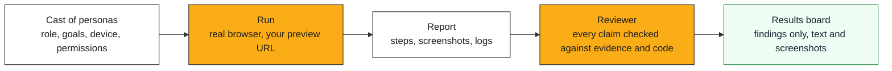

  <strong>Dummy Run</strong> 
  AI plays your users and tries your app before your customers do. 
  Every finding comes with its evidence.

> Dummy Run is in pre-release, and nothing here is ready to install yet. It comes from a private
> deployment that ran several hundred reviewed sessions against pull-request previews. Those sessions
> found permission leaks, crashes and accessibility blockers that the automated tests had missed. The
> engine, the reviewer and the results board move here over the coming weeks.

## In thirty seconds

A persona is a fictional user. It has a role and goals. It also has habits, a device and a set of
permissions.

A run puts one persona in a real browser and signs it in to your app. That is usually a preview built
for one pull request. Chrome and Firefox both work, through WebDriver BiDi. The persona then tries to do
its job.

The persona reports what broke and what confused it. It also reports anything it could see that its role
should hide. A reviewer checks each claim against the screenshots, the logs and the code. Only the claims
with evidence reach the results board.

Dummy Run is a crash test for software. The dummies take the hit so your users don't, and every impact is
on film.

## Who it is for

| You are | What you get |
|---|---|
| A QA lead | Role-aware exploratory testing on every pull request. Each finding can be reproduced, and there are no scripts to maintain |
| A solo developer | A second pair of eyes that uses your product the way a customer would. It runs on your laptop or in CI |
| An agency | One cast to run against every client's preview. Each client's data stays in the market you choose |
| Product and UX | Plain-language reports of friction and confusion. Each one points to the exact step and screenshot |
| Compliance and security | Permission leaks, meaning what a role can see or do beyond its rights. Each one is verified before it is raised |
| An executive | One board that shows what is broken and who it affects. It also shows how we know |

## How it works

- **Pluggable targets.** A target adapter finds the preview for a pull request. It creates a test user
  with the right role and loads the test data. The first adapter comes from the private deployment.
  Adapters for Vercel, Netlify, Cloudflare Pages and plain URLs follow.
- **Pluggable model providers.** Choose Vertex AI, Azure AI Foundry, Anthropic or a local model. You pick
  one per market. That keeps each run inside one jurisdiction, such as the UK or the EU.
- **Evidence or nothing.** The reviewer drops any claim that lacks a screenshot, a log line or a code
  reference.
- **Nothing is posted for you.** Findings go to the board. A person decides what becomes a ticket.

## Roadmap

The plan is in [docs/PLAN.md](docs/PLAN.md). The engine comes across first, with a clean history. A demo
app and an example cast follow, so you can watch a full run on a laptop. Then come the Helm chart and a
docker-compose setup. The Azure and Google Cloud adapters come last, and every release is tested on both.

## Documentation

| Document | What it covers |
|---|---|
| [docs/PLAN.md](docs/PLAN.md) | The extraction plan and the release order |
| [docs/ARCHITECTURE.md](docs/ARCHITECTURE.md) | Adapters, the evidence pipeline and data residency |
| [docs/STYLE.md](docs/STYLE.md) | How we write, cite and set type |
| [docs/NAMING.md](docs/NAMING.md) | How the name was chosen, with the rubric and its sources |
| [docs/LICENSING.md](docs/LICENSING.md) | Why Apache-2.0 and what it lets you do |
| [docs/TYPOGRAPHY.md](docs/TYPOGRAPHY.md) | Minimum sizes and the type scale |
| [docs/FREE-FOR-OSS.md](docs/FREE-FOR-OSS.md) | Services this project uses or plans to use |
| [CONTRIBUTING.md](CONTRIBUTING.md) | How to help, with the rules on evidence and privacy |
| [SECURITY.md](SECURITY.md) | How to report a vulnerability, and what to do with findings about other people's apps |

## Licence

Dummy Run is licensed under the [Apache License 2.0](LICENSE). The [trademark policy](TRADEMARKS.md)
covers the name and the logo. [docs/LICENSING.md](docs/LICENSING.md) explains the choice and what it lets
you do.
