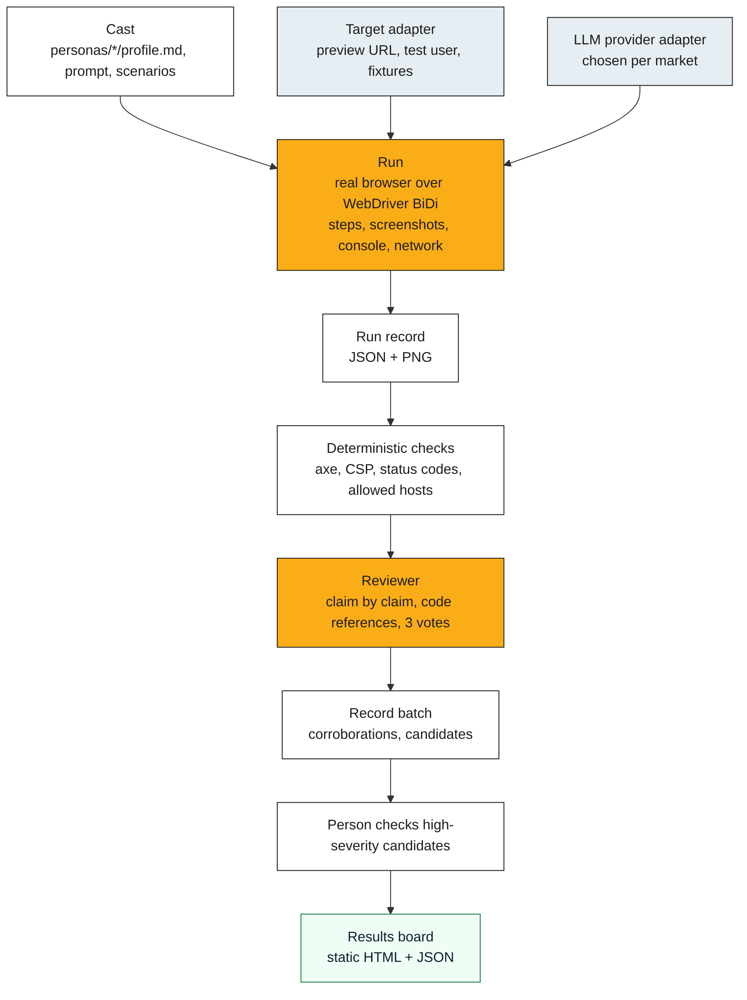

# Architecture outline

**Design note** · 18 October 2026 · maintainers

> - Four stages: cast, run, review, board. Each stage reads and writes plain files, so any stage can be
>   replaced or run by hand.
> - Everything that touches a cloud, a model or a target platform sits behind an adapter interface.
> - Data residency is a per-market setting that every adapter must be able to satisfy, not a deployment
>   accident.

## Stages

## Adapters

| Adapter | Responsibility | First implementations |
|---|---|---|
| Target | Resolve a preview for a change (PR number, branch or URL); create a test user with a named role; seed fixtures; say which hosts a run may touch | Plain URL; the preview-environment adapter from the private deployment, generalised; then Vercel, Netlify, Cloudflare Pages, GitHub Deployments |
| LLM provider | Play the persona; review claims. Separate models for the two jobs | Vertex AI (Gemini), Azure AI Foundry, Anthropic, OpenAI-compatible local |
| Runner host | Where the browser runs | Laptop; GitHub Actions; Kubernetes job (Helm); Cloud Run jobs; Azure Container Apps jobs |
| Results store | Where run records and the board live | Local directory; object storage (GCS, Azure Blob, S3); the board is always static files on top |
| Secrets | Test-user credentials and provider keys | OS keychain; CI secrets; Secret Manager; Key Vault |

An adapter declares the **regions** it can run in. A market profile (for example `uk`) lists the regions
that satisfy it (`europe-west2`, `uksouth`, `ukwest`). A run refuses to start if any adapter in the chain
cannot satisfy the market.

## The evidence rule

A finding is a claim plus evidence. The reviewer rejects a claim unless it can point to a step in the run
record with a screenshot, a console or network line, or a code reference that supports it. Findings carry
one of four tags: measured (we saw it in a run), code (read in the source), sourced (stated in a ticket or
document), inferred (our reasoning, and it says so). High-severity candidates wait for a person.

## Browsers

Chrome and Firefox through WebDriver BiDi, so the same session code drives both and we are not tied to one
vendor's protocol. Mobile is a viewport and user-agent profile per persona; real devices come through a
hosted browser grid adapter later (BrowserStack's open-source programme is the first candidate).

## Deployment

- `deploy/compose`: the solo-developer path, one command, local browser, local board.
- `deploy/helm/dummyrun`: a chart with a runner job template, a reviewer job, a board publisher, and a
  values file per cloud (`values-gcp.yaml`, `values-azure.yaml`).
- Integration matrix: every release runs the demo cast against the demo app on both clouds and compares
  the boards with `compare-batches`.
