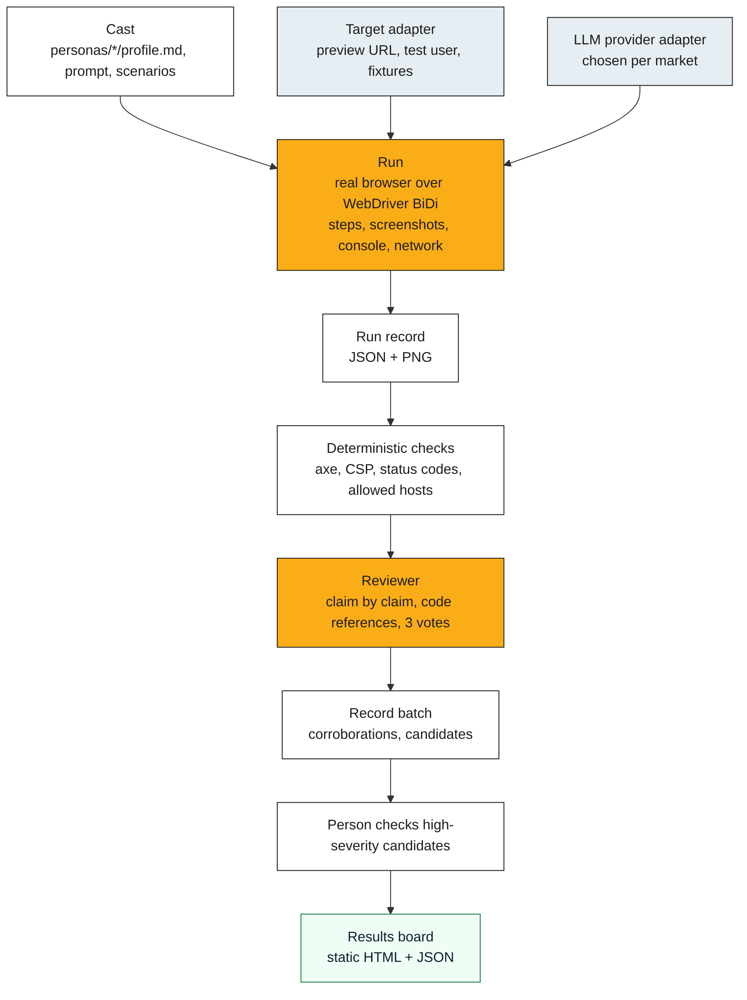

# Architecture

A run has four stages: cast, run, review and board. Each stage reads and writes plain files, so you can
replace any stage or run it by hand. Anything that touches a cloud, a model or a target platform sits
behind an adapter. Data residency is a per-market setting that every adapter must satisfy.

## Stages

## Adapters

| Adapter | Responsibility | First implementations |
|---|---|---|
| Target | Resolve a preview for a change (PR number, branch or URL); create a test user with a named role; seed fixtures; say which hosts a run may touch | Plain URL, built; then Vercel, Netlify, Cloudflare Pages, GitHub Deployments |
| LLM provider | Play the persona; review claims. Separate models for the two jobs | Azure OpenAI, Anthropic, Gemini on Vertex AI or the Developer API, Amazon Bedrock and any OpenAI-compatible service, all built. See [PROVIDERS.md](PROVIDERS.md) |
| Runner host | Where the browser runs | Laptop; GitHub Actions; Kubernetes job (Helm); Cloud Run jobs; Azure Container Apps jobs |
| Results store | Where run records and the board live | Local directory; object storage (GCS, Azure Blob, S3); the board is always static files on top |
| Secrets | Test-user credentials and provider keys | Environment variables, filled from the OS keychain, CI secrets, Secret Manager or Key Vault. Test-user credentials are read by name from the target file's `signin` block |

An adapter declares the regions it can run in. A market profile (for example `uk`) lists the regions
that satisfy it (`europe-west2`, `uksouth`, `ukwest`). A run refuses to start if any adapter in the chain
cannot satisfy the market.

## The evidence rule

A finding is a claim plus evidence. The reviewer rejects a claim unless a step in the run record
supports it. That support is a screenshot, a console or network line, or a code reference. Each finding
carries one of four tags:

| Tag | Meaning |
|---|---|
| measured | Seen in a run |
| code | Read in the source |
| sourced | Stated in an issue or document |
| inferred | Our reasoning, labelled as such |

High-severity findings wait for a person to confirm them. The page is untrusted input. The engine fences its text (code: `internal/inject/inject.go` and `internal/runner/observe.go`). It flags text that tries to instruct the persona (code: `internal/inject/inject.go` and `internal/runner/inspect.go`). It files a `security` finding for that text (code: `internal/runner/inspect.go`). See [Threat model](THREAT-MODEL.md).

## Browsers

Chrome and Firefox are driven through WebDriver BiDi, so the same session code drives both. A persona's
device sets the window size (desktop, tablet or phone), and a persona or scenario may set page zoom. The
user agent is the browser's own, with `DummyRun/<version>` added at the end. Real devices will come
through an adapter for a hosted browser grid.

## Deployment

Packaging is planned and none of it is built yet.

- `deploy/compose` will run everything on one machine with one command.
- `deploy/helm/dummyrun` will be a Helm chart with jobs for the runner and the reviewer and a board
  publisher. It will have a values file per cloud (`values-gcp.yaml` and `values-azure.yaml`).
- Every release will run the demo cast against the demo app on both clouds and compare the two boards.
