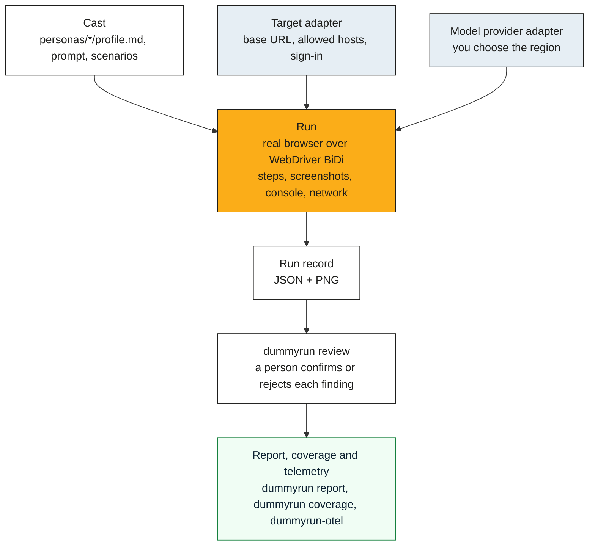

# Architecture

A run goes through a few stages: you pick a persona from a cast, the engine runs it in a browser, and a
person reviews what it found. Each stage reads and writes plain files, so you can swap one out or do it by
hand. Anything that talks to a model or a target app sits behind an adapter.

## Stages

## Adapters

| Adapter | What it does | What you can use today |
|---|---|---|
| Target | Says where the app is, which hosts a run may touch, whether the run is read-only and how a role signs in | A target file with a plain URL. See `examples/targets/` and "Sign in" in [ENGINE.md](ENGINE.md) |
| Model provider | Plays the persona | Azure OpenAI, Anthropic, Gemini on Vertex AI or the Developer API, Amazon Bedrock, and any OpenAI-compatible service. See [PROVIDERS.md](PROVIDERS.md) |
| Runner host | Where the browser runs | Your laptop, or a CI job such as GitHub Actions |
| Results store | Where run records live | A local directory, set with `--out` |
| Secrets | Test-user passwords and provider keys | Environment variables. The target file's `signin` block names them, and the engine reads them at run time |

You choose the provider and its region on each run with `--provider` and `--region`. To keep a run inside
a jurisdiction, use a model deployment in that market, such as Azure OpenAI in `uksouth` for the UK. The
persona's screenshots and page text go to that provider, and the region is written into the run record. Telemetry goes only to the OpenTelemetry backend
you configure, and [TELEMETRY.md](TELEMETRY.md) lists what it carries.

## The evidence rule

A finding is a claim plus evidence. Each one points at the steps in the run record that support it, such
as a screenshot or a console or network line. Each finding also says how the persona knows it:

| Tag | Meaning |
|---|---|
| measured | Seen in the run |
| code | Read in the source |
| sourced | Stated in an issue or a document |
| inferred | The persona's reasoning, labelled as such |

Every finding starts as pending. A person confirms or rejects it with `dummyrun review`, and the verdict
goes into the run record.

The page is untrusted input. The engine fences page text off from its instructions, flags text that tries
to instruct the persona and files a `security` finding for it. The [threat model](THREAT-MODEL.md) has
the details.

## Browsers

The engine drives Chrome and Firefox over WebDriver BiDi, so the same session code works in both. A
persona's device sets the window size (desktop, tablet or phone). A persona or scenario can also set page
zoom or a larger system text size. The user agent is the browser's own with `DummyRun/<version>` on the end,
and `--identify` adds a contact URL as well.

## Deployment

There's no packaged deployment yet, such as a container image or a Helm chart. Install the engine with
`go install` as [ENGINE.md](ENGINE.md) shows, and run it on your laptop or in a CI job.
