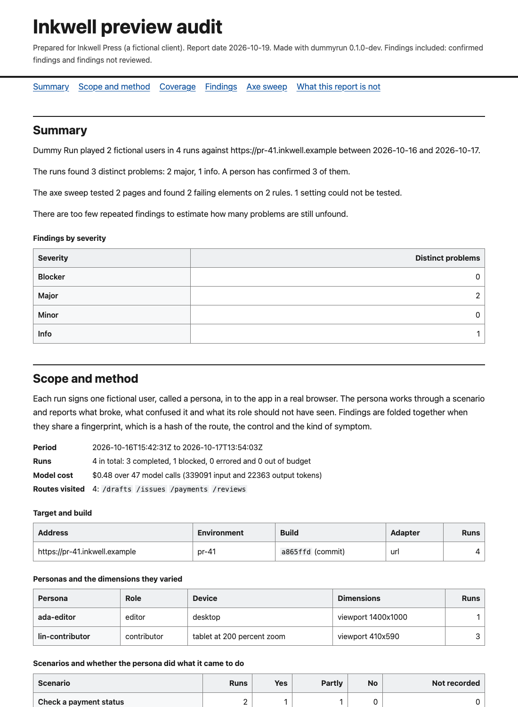

# The audit report

`dummyrun report` turns run records into a report for someone who was not there. Add the results of `dummyrun a11y` and the report covers pages as well as personas. The report is a sample, so read the limits at the end before you share it.



## Make a report

```sh
dummyrun report --runs examples/runs --build a865ffd \
  --a11y examples/report/a11y-sweep.json --include pending \
  --title "Inkwell preview audit" --client "Inkwell Press" --out report.html
```

The default format is one HTML file. It holds its own styles and screenshots and loads nothing from the network. Open it in a browser or print it to PDF. The print styles drop the contents list and ask the browser not to split a finding across pages.

| Flag | What it does |
|---|---|
| `--runs DIR` | A directory or a file of run records. Repeat the flag to read several. Paths may also follow the flags |
| `--a11y FILE` | A file from `dummyrun a11y --json`. Repeat the flag for several sweeps |
| `--title`, `--client` | The title, and free text naming who the report is for |
| `--format` | `html` (the default), `md`, `json`, `sarif` or `junit` |
| `--include pending` | Also include findings no reviewer has confirmed. Without it only confirmed findings appear |
| `--baseline FILE` | An earlier report in JSON form, to mark each finding new or still present |
| `--build SHA` | Report on one commit or build hash. At least 7 characters |
| `--date` | The report date as `YYYY-MM-DD`. The default is today |
| `--out FILE` | Write to a file instead of standard output |

Rejected findings never appear in any format. Observations, which are notes that are not problems, do not appear either.

## What is in it

1. The summary. It is plain language and says how many problems were found, how many a person confirmed and how many are not reviewed.
2. Scope and method. It names the target, the build and the dates. It lists the personas with the dimensions they varied, and the scenarios. It lists the browsers, the models and providers, the number of runs and the model cost.
3. Coverage. It reuses the numbers of [dummyrun coverage](COVERAGE.md).
4. Findings, worst first.
5. The axe sweep, when you gave one.
6. A comparison with the baseline, when you gave one.
7. What the report is not.

## Coverage

The coverage section says how much the sample can tell you. The line to read is "still unfound". It is the Chao2 lower bound on all distinct problems, less the number seen. It is a floor, never a count of what remains. The form of the estimate is named next to it.

Sample coverage is the share of the chance of finding a problem that sits in problems already found. Below 0.50 do not extrapolate from it. When the numbers cannot be estimated the report says so and does not print a guess. When the records come from more than one build, coverage is not computed and the report says why. Pass `--build` to pick one.

[COVERAGE.md](COVERAGE.md) explains each number and when to trust it.

## How to read a finding

Findings are grouped by fingerprint, so a problem that three runs found appears once. The list is sorted by severity and then by how many runs found the problem.

Each finding has these parts.

- Title, severity and kind, as the persona and the reviewer left them.
- Symptom, route and the control or region. These make up the fingerprint.
- Review status. A confirmed finding shows the reviewer, the date and the reason when the record has them. A finding without a verdict is marked not reviewed.
- The WCAG 2.2 success criterion when it is known. A persona finding has one only when its symptom names an axe rule that appears in a sweep you gave. Otherwise the report says it is not recorded.
- Fix guidance when there is some. For an axe rule it is the link to the rule's help page.
- Steps to reproduce, taken from the steps the finding cites. The report names the run and the persona. It also gives the role, the device and the browser.
- Screenshots of the cited steps, embedded in the HTML when the files are next to the record. A file that is missing is named and the report still builds.

A finding is not reviewed when its verdict is `pending`. Nobody has checked the model's claim against the evidence. The HTML marks it with a dashed badge and the words "Not reviewed". Read those findings as leads.

When a problem was found in several runs and only some were confirmed, the problem counts as confirmed. The list of runs marks the sightings that are not reviewed.

## The axe sweep

The sweep section folds the results of every page and setting into one entry for each rule. It shows the impact and the WCAG criteria. It lists the pages and elements and the settings in which the rule failed. Elements on the allow-list are counted and left out. Rules that axe cannot decide are listed apart under "needs a person to check". Pages that could not be tested are listed too.

## Compare with an earlier report

Write the earlier report as JSON and give it back with `--baseline`.

```sh
dummyrun report --runs runs/week-1 --format json --out week-1.json
dummyrun report --runs runs/week-2 --baseline week-1.json --out week-2.html
```

Findings are matched by fingerprint, and axe rules by rule. Each is marked new or still present. A problem that the baseline had and the new report did not find again is listed as fixed. Axe rules are listed only when the new report has a sweep that tested every page, and persona findings only when it has runs. A sample can miss a problem that is still there, so check a fixed problem before you close it.

## Other formats

| Format | Use |
|---|---|
| `md` | The same report as Markdown, for a pull request or a wiki. Screenshots are links to the files |
| `json` | The full data, described by [schema/report.schema.json](../schema/report.schema.json). It is the input for `--baseline` |
| `sarif` | SARIF 2.1.0 for tools that read it. Each problem and each failing axe element is a result. The location is the page address and not a file in your repository, so GitHub code scanning cannot place a result on a source file |
| `junit` | JUnit XML for a CI job. Blocker, major and minor problems and failing axe rules are failures. Info problems are skipped |

## The limits

The report prints these limits on its last page.

- It is a sample. Personas played a set of scenarios on the builds listed under scope. A problem they did not meet is not in it.
- It is not a WCAG conformance claim, a certificate or a statement about the law.
- Automated checks find only some accessibility problems. The sweep covers the pages it lists and nothing else.
- It does not replace testing with disabled people.
- A finding marked not reviewed is a claim by a model that no person has checked.
- Parts of the app that no run visited are not covered, whether or not the report has findings.

The report never says that the target passed or is compliant. A test in `internal/report` fails when the templates or any rendered format use those words. A report with no findings says that the runs found none and that this says little on its own.

## Example

`examples/report/` holds a report made from the synthetic runs in `examples/runs/` and a synthetic sweep. `examples/report/generate.sh` rebuilds it, and a test fails when the committed files are out of date. The records there have no screenshot files, so the HTML names the missing ones.
