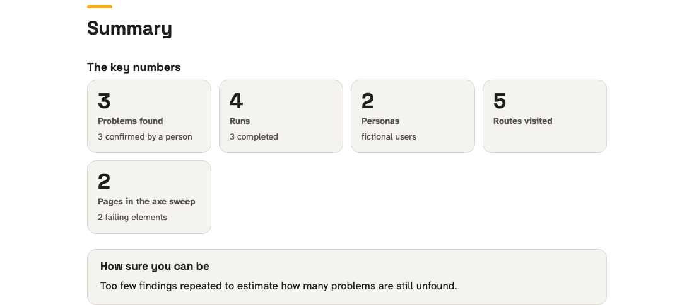
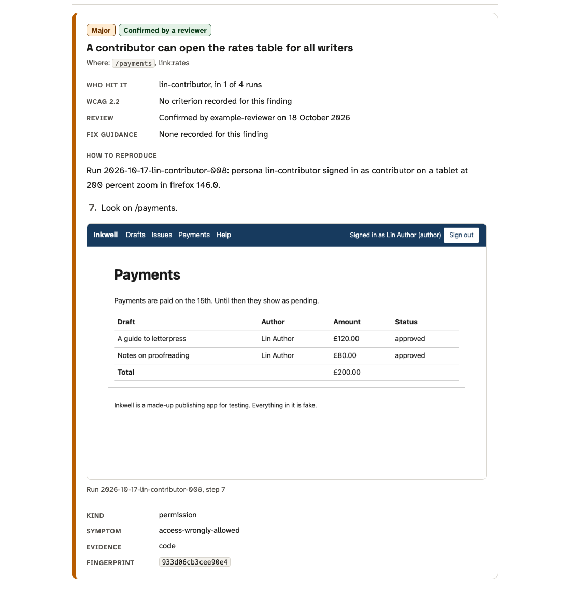
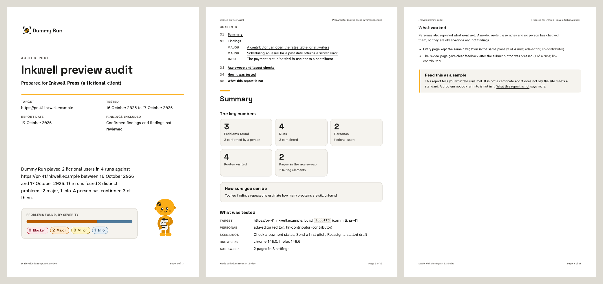

# The audit report

`dummyrun report` turns your run records into a report you can hand to someone who wasn't there. Add the
results of `dummyrun a11y` and it covers your pages as well as your personas. The report is a sample, so read
[the limits](#the-limits) before you share it.


## Make a report

```sh
dummyrun report --runs examples/runs --build a865ffd \
  --a11y examples/report/a11y-sweep.json --include pending \
  --title "Inkwell preview audit" --client "Inkwell Press" --out report.html
```

You get a single HTML file with its styles and screenshots inside it. It loads nothing from the network. Open
it in a browser or print it to PDF. When you print, each section starts on a new page and a finding stays in one
piece where it fits. Browsers that print page margins put the title and page numbers in them.

| Flag | What it does |
|---|---|
| `--runs DIR` | A directory or a file of run records. Repeat the flag to read several. Paths can also follow the flags |
| `--a11y FILE` | A file from `dummyrun a11y --json`. Repeat the flag for several sweeps |
| `--title`, `--client` | The title, and free text naming who the report is for |
| `--format` | `html` (the default), `md`, `json`, `sarif`, `junit`, `badge` or `shields`. [BADGES.md](BADGES.md) covers the last two |
| `--include pending` | Also include findings no reviewer has confirmed. Without it, you only see confirmed findings |
| `--baseline FILE` | An earlier report in JSON, so each finding is marked new or still present |
| `--build SHA` | Report on one commit or build hash, at least 7 characters long |
| `--date` | The report date as `YYYY-MM-DD`. The default is today |
| `--out FILE` | Write to a file instead of standard output |

Rejected findings never appear in any format. Neither do observations, which are notes about things that
worked.

## What is in your report

The HTML report is built to be read, handed on and printed. It uses the Dummy Run typefaces, Space Grotesk and Atkinson Hyperlegible Next, which are embedded in the file. It has a light theme for print and screen, and a dark one on screen only when your system asks for it. The example is `examples/report/report.html`, and it is about 150 KB with its fonts, logo and one screenshot.

### The cover

It has the logo, the title and who the report is for (`--title` and `--client`). Under them are the target, the dates of the runs, the report date and which findings are counted. A short paragraph says in plain words what was run and what it found. A bar and four labelled chips count the problems by severity. The severity is always written out, so no one has to tell the colours apart. The cover leaves room for an agency logo: put it inside the element with the class `cover-brand` in your copy.

### The summary

Cards give the key numbers. They cover problems found, runs, personas and routes visited. They also cover the pages in the axe sweep and, with a baseline, what is new. "How sure you can be" says in plain words how many problems are still unfound, as a floor and not a count. The page also says what was tested and what worked. It ends with a short reminder that the report is a sample.



### The findings

A contents list links to every finding, grouped by severity. Each finding is a card with a colour band and three badges for severity, review and confidence. It says where the problem is as a person would, for example "the Payments page, the Rates link". It says what went wrong in plain words and who hit it. The steps to reproduce read as things to do, such as signing in as a contributor and opening a page. The screenshot has a caption, and for a permission or security finding a line says what to look at. Rows with nothing to say are left out. A collapsed "Technical details" block holds the run, the steps, the fingerprint and the other raw fields. It is open in print.



### The axe sweep and layout checks

One table lists each rule with its severity, its impact, WCAG criterion, the number of elements, how sure you can be of it and a link to the fix guidance. A second shows where each rule failed. When a failed rule is one of Dummy Run's own checks, a section after them says how to fix it. Each entry has a one-line summary and the steps to take. It says who usually makes the change: content, design or development. Most entries also show an example and link the guidance the advice follows. The steps are general, so check them against the elements the report lists. With `--baseline`, each finding and rule is labelled new or still present, and a section lists what was not seen again.

### On paper

Print to PDF from the browser. Each section starts on a new page, and in browsers that print page margins the margins carry the report title, who it is for and the page number. The first page, the cover, has none.



The pictures are rebuilt by `examples/report/screenshot.sh`. Opening the HTML makes no request to the network. A test checks that the fonts, logos, icon and images are data URIs. The links you click, such as the fix guidance, still go to the web. The Markdown format has the same parts as headings and tables.

## What is in it

1. A plain-language summary of how many problems were found, how many a person confirmed and how many
   are still unreviewed.
2. Scope and method. This names the target, the build and the dates. It lists the personas, the dimensions
   they varied and the scenarios. It also lists the browsers, the models and providers, the number of runs and
   what the model calls cost.
3. Coverage, using the same numbers as [dummyrun coverage](COVERAGE.md).
4. Findings, worst first.
5. What worked, if the runs hold observations. These are a model's notes that no person has checked. They
   aren't findings and never enter a count.
6. The axe sweep, if you gave one.
7. A comparison with the baseline, if you gave one.
8. What the report is not.

## Coverage

The coverage section tells you how much the sample can say. Start with "still unfound", which is
the Chao2 lower bound on all distinct problems minus the number already seen. Treat it as a floor. It never
counts what remains, and the form of the estimate is named beside it.

Sample coverage estimates how likely the next problem a run meets is one you've already found. At 0.90,
that's about 9 times in 10. Below
0.50, don't extrapolate from it. When a number can't be estimated, the report says so instead of guessing. If
your records come from more than one build, coverage isn't computed and the report tells you why. Pass
`--build` to pick one.

[COVERAGE.md](COVERAGE.md) explains each number and when to trust it.

## How to read a finding

Findings are grouped by fingerprint, so a problem that three runs found appears once. They're sorted by
severity, then by how many runs found them.

Each finding shows:

- the title and kind, as the persona and the reviewer left them, and the severity the rule below gave it
- the symptom, the route and the control or region, which together make the fingerprint
- the review status, with the reviewer, date and reason when the record has them
- how sure you can be of it: high, medium, low or not yet known, with one line saying what it rests on
- the WCAG 2.2 success criterion, when it's known
- fix guidance, when there is some (for an axe rule, a link to the rule's help page)
- how to fix it, when the rule is one of Dummy Run's own: the same summary, owner and steps, also in the JSON as `fix`
- steps to reproduce, taken from the steps the finding cites
- the run and persona that found it, with the role, device and browser
- screenshots of the cited steps

A persona finding only gets a WCAG criterion when its symptom names an axe rule that appears in a sweep you
gave. Otherwise, the report says it isn't recorded. Screenshots are embedded when the files sit next to the
record. If one is missing, the report names it and still builds.

A finding with a `pending` verdict hasn't been reviewed, so nobody has checked the model's claim against the
evidence. The HTML marks it with a dashed badge and the words "Not reviewed". Read those findings as leads.

When several runs found a problem and only some sightings were confirmed, the problem counts as confirmed. The
list of runs marks the sightings nobody has reviewed.

## How severity and confidence are decided

Severity says how much a problem matters if it is real. Confidence says how likely it is to be real. Neither is
a model's opinion. A persona can propose a finding, but it is never asked how serious it is or how sure it feels.
Both come from facts the engine recorded.

### Severity

Severity follows a fixed rule. Each check has an impact class, the one axe-core gives its rules or the one each of
Dummy Run's own checks declares. Critical is a blocker, serious is major, moderate is minor, and minor or no impact
is info. A problem on a journey a persona was trying to complete moves up one step, because it stands between
someone and what they came to do. So does a problem on three or more pages, because a pattern across the site is
worth fixing once. Neither goes above major: only a critical impact makes a blocker. A failure of a WCAG level A
criterion is never below minor.

A persona finding gets the impact class of its symptom. A control that cannot be reached or operated, or access
that is wrongly allowed or denied, is serious. A wrong outcome, an error, a broken layout or an unclear label is
moderate. Missing information is minor. A finding that names an axe rule which the persona's own accessibility
check reported, on the element the finding is about, takes that rule's impact. A persona met its problem while
doing a task, so its findings count as on a journey. A reviewer can still change a severity in `dummyrun review`, and the record keeps that.

### Confidence

Every finding records the facts it rests on: what kind of evidence it is, which rule engines agree, whether it
came back in repeated runs, whether it is on a journey, and which check produced it. There are five kinds of
evidence today. A measurement is made in the browser, such as the size of a target. A fact can be read from the
page's accessibility tree, such as a missing name. A rule engine can report a result. A task can fail when Dummy Run tries it, such as a control that works by
mouse but not by keyboard. Or the finding is the persona's own report, with no check behind it.

Confidence is a lookup. Dummy Run keeps a table of how often findings with each combination of those facts have
turned out to be right. The rule engine figures come from running the engines over the W3C's published test
pages, where the right answer for each page is known. The persona figures come from findings that were checked by
hand against the page. The table says where each figure came from. A finding is high when findings like it are
right at least four times in five, after allowing for how few have been checked; medium when at least half are;
and low otherwise. The table is read from the most specific match outward: a rule's own record comes first, then
the record of the engines that agree on it. More engines agreeing is never weaker evidence than fewer, so the
record of a smaller set of engines is a floor for a larger one. An engine with no record of its own borrows nothing
from the others.

A combination with fewer than ten checked findings is not yet known, and the report says so rather than guessing.
When a rule has too few checked findings of its own, its band comes from all findings of its kind together, and
the line says so with the number pooled. A finding with nothing but the persona's word behind it is low until the
table says otherwise. Each finding's one line says what it rests on, for example "Three engines agree (axe-core,
IBM Equal Access, Siteimprove Alfa), and it happened in all 3 runs."

The table ships with the engine, in `internal/confidence/table.json`, and says where each figure came from. If you
check findings yourself, you can rebuild it from your labels. Write them as a JSON array of `{"inputs": {...},
"true": true}` objects, where `inputs` is the finding's `inputs` block from its run record, and run:

```sh
dummyrun calibrate --labels my-labels.json --out-table table.json --report calibration.md
```

The report shows each band's observed accuracy, each bucket's stated accuracy against the labels it rated, and
whether the bands discriminate (whether a higher band is right more often than the one below it). Pass `--eval`
with labels the table was not built from to test it fairly. [CLI.md](CLI.md) has every flag.

## The axe sweep

The sweep section folds every page and setting into one entry per rule. Each entry shows the impact and the
WCAG criteria, plus the pages, elements and settings where the rule failed. Elements on your allow-list are
counted and left out. Rules axe can't decide are listed separately under "needs a person to check", and so are
pages that couldn't be tested.

Axe's best-practice rules, such as content outside any landmark or headings that skip a level, have their own
table, "Advice beyond WCAG A and AA". A few of them are WCAG AAA rules. They aren't WCAG A or AA failures, so
they aren't counted as failing elements. The report's JSON keeps them in `axe.advice` and the tags checked in
`axe.advice_tags`. A sweep made before advice existed has none.

Layout rules appear in the same section when the sweep ran with `--layout`, or with a `--text-scale` above 100, which turns `--layout` on. Keyboard rules appear there when it ran with `--keyboard`, and markup rules when it ran with `--markup`. The report lists them with the axe rules. The rule IDs all begin `dummyrun-`. The layout rules map to WCAG 1.4.10, 1.4.4, 2.5.8 and 2.4.11. The keyboard rules map to WCAG 2.1.1, 2.1.2, 2.4.7 and 2.4.1. The markup rules map to WCAG 1.3.5 and 2.5.3. The layout and keyboard rules are measurements made in the browser, except `dummyrun-mouse-only`, which is a task the sweep tried and could not complete. The markup rules are facts read from the accessibility tree. Each help link goes to the W3C page for the criterion. The settings of a rule end in `/text-200` when the sweep used a text size of 200 percent, for example `chrome/phone/light/text-200`. Persona runs at a larger text size are listed with the device, as in "phone with text at 200 percent". [ENGINE.md](ENGINE.md) explains the checks.

## EN 301 549 and the law

Where EN 301 549 V3.2.1 has a clause for a WCAG criterion, a report names it too. The standard is
[EN 301 549 V3.2.1](https://www.etsi.org/deliver/etsi_en/301500_301599/301549/03.02.01_60/en_301549v030201p.pdf),
the European standard for accessible ICT. Its clause 9 covers web pages and numbers each WCAG 2.1 criterion with a 9 in
front, so WCAG 1.4.3 is clause 9.1.4.3. The JSON has them in `en_301_549` on each finding and axe rule. Version 3.2.1
follows WCAG 2.1, so the six criteria WCAG 2.2 added at A and AA have no clause: 2.4.11, 2.5.7, 2.5.8, 3.2.6, 3.3.7 and
3.3.8. The report still lists them under WCAG 2.2.

The standard and WCAG come up in these laws and rules:

- **UK public sector.** The [Public Sector Bodies Accessibility Regulations 2018](https://www.legislation.gov.uk/uksi/2018/952/contents/made)
  cover websites and apps. [GOV.UK guidance](https://www.gov.uk/guidance/accessibility-requirements-for-public-sector-websites-and-apps)
  asks you to check them against WCAG 2.2 and publish an accessibility statement.
- **Any UK organisation.** The [Equality Act 2010](https://www.legislation.gov.uk/ukpga/2010/15/section/20) asks
  organisations that provide services to make reasonable adjustments for disabled people. It names no standard, so
  WCAG is the usual way to show what you did.
- **EU public sector.** The [Web Accessibility Directive](https://eur-lex.europa.eu/eli/dir/2016/2102/oj) uses
  EN 301 549.
- **EU businesses.** The [European Accessibility Act](https://eur-lex.europa.eu/eli/dir/2019/882/oj) covers
  products and services such as online shops, banking and e-books, from 28 June 2025. The Act sets requirements
  and leaves the technical detail to harmonised standards. EN 301 549 is the usual technical reference for websites
  while those are settled.

A report is evidence for this work, never a verdict on it. Automated checks and personas find only some barriers,
so a report can't show that a site meets EN 301 549 or the law. An accessibility statement or an audit for one of
these needs a person to test every criterion. Take legal advice on what applies to you.

## Compare with an earlier report

To see what changed since last time, write the earlier report as JSON and pass it back with `--baseline`:

```sh
dummyrun report --runs runs/week-1 --format json --out week-1.json
dummyrun report --runs runs/week-2 --baseline week-1.json --out week-2.html
```

Findings are matched by fingerprint, and axe results by rule. Each finding in the new report is marked new or
still present. A problem the baseline had that the new runs didn't find again is listed as fixed. Axe rules
only appear in the comparison when the new report has a sweep that tested every page, and persona findings
only when the new report has runs.
A sample can miss a problem that's still there, so check a fixed problem before you close it.

## Other formats

| Format | Use |
|---|---|
| `md` | The same report in Markdown, for a pull request or a wiki. Screenshots are links to the files |
| `json` | The full data, described by [schema/report.schema.json](../schema/report.schema.json). It's what `--baseline` reads |
| `sarif` | SARIF 2.1.0 for tools that read it. Each problem and each failing axe element is a result. The location is a page address rather than a file in your repository, so GitHub code scanning can't place a result on a source file |
| `junit` | JUnit XML for a CI job. Blocker, major and minor problems and failing axe rules are failures. Info problems are skipped |

## The limits

The HTML report prints these on its last page.

- It's a sample. Personas played a set of scenarios on the builds listed under scope. A problem that no scenario
  ran into isn't in it.
- It isn't a WCAG conformance claim, a certificate or a statement about the law.
- Automated checks find only some accessibility problems. The sweep covers the pages it lists and nothing else.
- It doesn't replace testing with disabled people.
- A finding marked not reviewed is a model's claim that no person has checked.
- Parts of the app that no run visited aren't covered, whatever the findings say.

The report never says the target passed or is compliant. If the runs found nothing, it says so and adds that
this tells you little on its own.

## Example

[examples/report/](../examples/report/) holds a report built from the synthetic runs in
[examples/runs/](../examples/runs/) and a synthetic sweep. The records cite screenshots, and
`examples/runs/screens/` holds the one the first finding uses, a capture of the Inkwell test app. The HTML names
the others as missing. `examples/report/generate.sh` rebuilds it, and a test fails when the committed files are
out of date.
