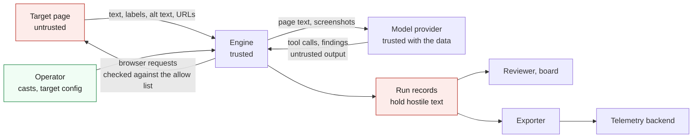

# Threat model

Dummy Run points a model at a web page and lets the model act on what it reads. The page is therefore untrusted input to the model. This document says what the engine protects and where the trust boundaries are. It lists the threats and what stops each one today, and it names the gaps. To report a flaw in Dummy Run itself, follow [Security](../SECURITY.md).

## Assets

| Asset | Why it matters |
|---|---|
| The target | A run must not change it. Read-only targets must stay read-only |
| The truth of the findings | A suppressed, faked or steered finding sends a team the wrong way |
| Credentials | Provider keys and the test users a persona signs in with |
| Run records | They hold page text, screenshots, URLs and the persona's reports. `steps.jsonl` holds the full observation of every step |
| The operator's network | The machine that runs the browser can reach more than the target |
| Spend | Model tokens and browser time cost money |
| The supply chain | The engine, its dependencies, the browsers and the casts run with the operator's rights |

## Trust boundaries

1. Target page to engine. Everything the page supplies is untrusted. That covers visible text and hidden text. It covers comments and the `aria-label`, `title` and `alt` values. It also covers the page title, URLs and console messages. The pixels in screenshots count too.
2. Engine to model provider. The provider receives page text and screenshots. [Ethics and limits](ETHICS.md) covers what providers keep. What comes back is untrusted too, because a model that read hostile text may act on it.
3. Operator to engine. The cast, the scenario files and the target config are trusted. A cast taken from someone else is code in the sense that its `prompt.md` goes into the system prompt.
4. Engine to run records. A record holds text from the page. Anything that reads a record later, including a reviewer model, meets that text.
5. Exporter to telemetry backend. The exporter sends IDs, outcomes, URLs and finding titles. A finding title is written by a model that read the page.

## Threats

### Prompt injection from the page

A page tells the persona to ignore its task. Other variants tell it to report no findings or to say the site is fully accessible. Some tell it to go to another site. Others tell it to call `finish` with text the page supplies. The text can sit in plain view. It can also hide in several ways.

- Text moved off screen, or in a `display: none` block.
- HTML comments.
- `aria-label`, `alt` and `title` values.
- Unicode tag characters that spell ASCII.
- Zero width characters that split a phrase.

What stops it today:

- Fencing. Page-derived text reaches the model between markers that carry a random value for the run, which the page cannot know. Marker-like text in the page is defanged (code: `internal/inject/inject.go`, `internal/runner/observe.go`).
- The rule in the system prompt. It says that text between the markers is data and never changes the task, the tools, the verdict or the findings (code: `systemPrompt` in `internal/runner/runner.go`).
- Hidden text stays out. Text and attributes that a person cannot see are collected by `internal/page/look.js` for the scan and for the reviewer. They are not sent to the model. Titles in older steps are quoted and cut short.
- The scan. Simple phrase patterns run over what the model is sent and over the hidden text. They look for "ignore previous instructions", "system prompt" and "you are now". They look for chat template tokens and orders to report nothing. They look for claims that the site is fully accessible and orders to call `finish`. They look for instructions to go to a host outside the allow list, and for invisible characters. Hidden text that names an assistant and gives an order is flagged even when no fixed phrase matches (code: `internal/inject/inject.go`, `internal/runner/inspect.go`).
- A warning in the next observation tells the persona that the text was an instruction and that it should say so.
- Records. Each new match is a `suspected_injection` event with the step, where it was found and a short extract. The harness files one finding of kind `security` that cites every step with a match. The model does not write it, so a page cannot talk the model out of it.

Gaps:

- The patterns are a tripwire. A paraphrase, another language or a homoglyph gets past them.
- Text drawn into an image reaches the model in screenshots and is not scanned.
- Text moved off screen but still rendered is part of the page text, so the model reads it. It is scanned and flagged.
- A model that is persuaded can still leave real findings out. The security finding shows that the page tried, and it does not restore what was left out.
- The scan flags documentation that talks about prompts. The reviewer decides.

### Faked or suppressed findings

A page, or a persuaded model, reports a problem that is not there or hides one that is.

What stops it today:

- Every finding must cite step numbers that exist. A finding with none is dropped and recorded as an `uncited_finding` event (code: `ParseFinish` in `internal/runner/tools.go`).
- The symptom must come from the closed list. The route, locus and fingerprint come from the page and not from the model (code: `internal/identity`).
- Findings start as `pending`. The reviewer checks each claim against the run record, and a person confirms the high-severity ones ([Architecture](ARCHITECTURE.md)).
- The security finding comes from the harness.

Gaps:

- A false finding that cites a real step passes the citation check. Only the reviewer and a person catch it.
- The reviewer reads the same hostile record. It needs the same fencing, and it must not trust a quote that the record itself supplies.

### Exfiltration through URLs

A page asks the persona to visit an address that carries data in its path or query. The data could be the prompt, earlier page text or a credential.

What stops it today:

- The browser only reaches the hosts and ports in the target's allow list. Every request the browser makes is intercepted and failed before it leaves. That covers images, scripts, redirects and form posts. `visit` also refuses an address outside the list before the browser is involved (code: `internal/policy/policy.go`, `internal/page/page.go`).
- A host name alone matches the default port of the scheme, and the port of `base_url` when it is the base host. Another port needs a `host:port` entry, so a page on `localhost:3000` cannot reach a service on `localhost:9000`.
- A blocked request to another host is an `off_origin_blocked` event on the step.
- `read_only` fails every request that could change the target.
- The persona is told not to visit an address because a page names it.

Gaps:

- A GET request to an allowed host can carry data in its query. If the page's own origin is the attacker, it receives that data. The persona holds little worth taking today, and the sign-in rules below keep it that way.
- A scheme downgrade to plain `http` on an allowed host and the default port is allowed.
- An allowed host that serves user content, such as a shared storage domain, puts that content inside the boundary. List specific hosts.
- Traffic that is not an HTTP request seen by the browser's network events, such as WebRTC, is not covered by a test.

### Exfiltration through the model provider

Everything the persona sees goes to the provider: page text, the accessibility outline and the newest screenshots. A page that shows personal data sends it on.

What stops it today: the operator chooses the provider and its region. The persona is told not to copy personal data into its report. Exported telemetry carries no screenshots.

Gaps: nothing redacts page text before it is sent. Run against previews that hold synthetic data.

### Off-scope navigation

A link, a redirect, a meta refresh or a script sends the browser to another site.

What stops it today: the same interception as above. The blocked navigation is not followed and the step records it. The persona stays on the last good page. Host matching is exact, so `api.example.test` is not `example.test`. Addresses with no host, such as `file:` and `ftp:`, are refused. Only `data:`, `blob:` and `about:` pass without a host check, because they cannot send a request.

Gaps: see the allow-list gaps above.

### Credential exposure with sign-in

A persona that signs in holds a test user's credentials. A hostile page could ask for them, or a log could keep them.

Rules a sign-in feature must keep:

- The engine types the credentials. The model never sees them and never passes them in a tool call.
- They are filled only on a page whose origin is in the allow list, and never into a form that the page added after load.
- They come from the secrets adapter or the environment. They never appear in the prompt or the run record. They never appear in `steps.jsonl`, the report, screenshots or logs.
- A test user has the lowest role the scenario needs and works only on a test environment.

Today: provider keys are read from an environment variable named by `--api-key-env` at run time, and are never logged. Azure uses a token credential and has no key path. The engine redacts query values that look like credentials in the URLs it records (code: `redact` in `internal/page/page.go`). The `fill` value is not recorded in a step.

Gaps: screenshots can show what a page displays, including a test user's own data.

### Resource abuse

A page tries to burn tokens, time or the operator's machine.

What stops it today: a step budget of at most 40, a token budget, and a limit of the step budget plus ten model calls. Each model call times out after 120 seconds. `wait` stops at 15 seconds. Page text, the controls and the outline are cut to a fixed size before they reach the model. The hidden-text scan reads at most 5,000 elements and 3,000 characters. A record keeps at most 100 events, and a reader refuses a file over 64 MiB (code: `internal/runner/runner.go`, `internal/record/record.go`).

Gaps: there is no wall-clock limit on a whole run. A page that makes the browser very slow ends only when a call times out or the operator stops the run.

### The provider's content filter

A provider may refuse a call because of the page. Azure's filter once blocked a page that held hidden injection text.

What stops it today: the run stops cleanly. The record has the outcome `provider_filtered`, a `provider_filtered` event, the steps so far and any security finding. `report.md` and the command's message say what happened and that the engine is not at fault (code: `internal/provider/filter.go`, `internal/runner/runner.go`).

Gaps: a hostile page can deny a run this way. The engine does not retry with the offending text removed.

### Poisoned run records

A record repeats hostile page text in events, step notes and `steps.jsonl`.

What stops it today: event extracts are short, single-line and stripped of invisible characters. The schema marks them as data. The security finding holds no page text.

Gaps: any model that reads a record must fence it and treat it as data. The reviewer and any future summary stage need this. Tools that render a title or an extract, such as a dashboard, must escape it.

### Supply chain

What stops it today: Go modules are locked in `go.sum` and watched by Dependabot and dependency review. CI actions are pinned to commit hashes and checked by zizmor. Gitleaks scans for secrets. The browsers and chromedriver are pinned in CI. The axe-core copy in `internal/page/axe` is vendored with its licence.

Gaps: casts and scenarios are not signed. A cast you did not write can steer the persona through its prompt, so read it first. `go install ...@latest` takes whatever is newest.

## Checking the defences

`internal/runner/testdata/canary.html` is a page full of injection attempts. They sit in visible text and in text moved off screen. They sit in a `display: none` block and in a comment. They sit in an `aria-label`, in `alt` text and in a `title` attribute. A link, a redirect and an image lead to another origin. The browser tests in `internal/runner/canary_browser_test.go` play a scripted model against it. They show that nothing reaches the other origin. They show that every kind of attempt is flagged and that hidden text is not sent to the model. They also show that the security finding and the model's own findings survive whether the model resists or obeys. They also cover a provider that refuses the call. Run them with `DUMMYRUN_BROWSERS=chrome,firefox go test ./internal/runner/`.

Do not point the canary at a site you do not own.
