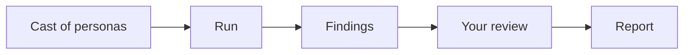

A persona is a made-up user with a role, a goal, a few habits and a device. Sam is an author on a phone who wants to reply to an editor's comments. Noor is blind and moves through a page by its headings. Vik can read everything in your app and shouldn't be able to change anything.

When you start a run, Dummy Run opens Chrome or Firefox, signs the persona in to your app and hands it a job, such as "submit a draft" or "reset your password". The app is usually a preview built for one pull request, though any address works. A model reads each page the way the persona would, decides what to do next and does it. When it finishes, you get a record of every step, a screenshot of each one and the persona's own account of what broke, what confused it and anything its role shouldn't have been able to see.





[Watch a real run](watch-a-run.md) of this website to see what a persona sees and does at each step.

## Does it replace a scripted suite?

No, and it isn't meant to. A script checks the steps you wrote, the same way every time, which is exactly what you want for regressions. A persona chooses its own path, so it can wander into the journeys nobody wrote a script for. When it finds something you never want to see again, write a test for it. [Beside your scripted suite](for/qa-lead.md) compares the two side by side.

## Your app, your model

You point a run at a target file that says where the app lives, which hosts the persona may touch and whether it may change anything. With `"read_only": true` the browser blocks every request that could change data, so it's safe to run against a site you care about. If the app needs a sign-in, the engine logs in with a test account before the persona starts. That sign-in request is the one change it allows, and the persona never sees the password.

The persona runs on the model you choose. Azure OpenAI, Anthropic, Gemini (on Vertex AI or the Developer API) and Amazon Bedrock all work, and so does any OpenAI-compatible service, including a model on your own machine. You pick the region with `--region`, and every run record notes where the model ran. [The provider guide](../../docs/PROVIDERS.md) shows what each one needs.

## Checking the findings

A model can be wrong, so every finding starts as pending and points at the steps and screenshots behind it. You go through them with `dummyrun review`, which shows each finding with its evidence and asks you to confirm or reject it. Your name and the time go into the run record with your decision. A rejection needs a reason, so whoever reads the record later knows why.

Nothing is filed for you. You decide which findings become tickets, either by copying them into your tracker or with a script that reads the run record JSON.

## Sharing what you found

`dummyrun report` turns a set of runs into one HTML file you can send to anyone or print to PDF. It lists what was tested, the confirmed findings by severity with their screenshots, and plainly what the report doesn't claim. The same command can write SARIF or JUnit for your CI, and a small badge for your README. Run `dummyrun coverage` to see how much of the app the personas reached and whether more runs are still turning up new problems.

You can also send runs to Grafana, or any OpenTelemetry backend, and follow a persona through your app next to your own traces.

## What leaves your network

The persona is a model looking at your pages, so the provider you choose receives the page text, and screenshots for every persona except the screen-reader one. Use previews that hold test data. The telemetry you export carries no screenshots. It does carry page addresses, button labels and finding titles, and a title can quote a few words from the page. It goes only to the OpenTelemetry backend you configure. [Telemetry](../../docs/TELEMETRY.md) lists every field.

## Words we use

| Word | Meaning |
|---|---|
| Persona | A made-up user with a role, goals, habits and a device |
| Cast | A set of personas. The [persona library](personas.md) has ready-made ones |
| Scenario | One job a persona tries to do |
| Preview | A copy of your app built for one pull request |
| Run | One persona working through one scenario |
| Run record | The JSON file a run writes, with its screenshots |
| Finding | Something the persona hit, with the steps and screenshots that show it |

The crash-test theme is where the name comes from, and why the cast are sometimes called dummies. Meet the [mascot](../../brand/README.md).
