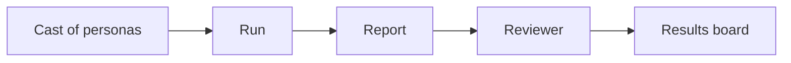

A persona is a fictional user with a role, goals, habits and a device.

A run signs one persona in to your app in Chrome or Firefox. The app is usually a preview built for one pull request. The persona tries to do its job and reports what broke, what confused it and what its role should not have seen. A reviewer checks each claim against screenshots, logs and code. Only claims with evidence reach the results board.

## Targets and models

An adapter finds the preview for a pull request, creates a test user with the right role and loads test data. The first adapter takes a plain URL. Adapters for GitHub Deployments, Vercel, Netlify and Cloudflare Pages follow. The adapter also says which hosts a run may touch.

The persona and the reviewer are two separate model roles. Providers are Vertex AI, Azure AI Foundry, Anthropic and OpenAI-compatible local models. Choose one per market to keep runs inside a jurisdiction such as the UK or the EU.

## Evidence

A finding is a claim plus evidence. The reviewer rejects a claim unless a step in the run record supports it. That support is a screenshot, a console or network line, or a code reference. Each finding carries one of four tags.

| Tag | Meaning |
|---|---|
| measured | Seen in a run |
| code | Read in the source |
| sourced | Stated in an issue or document |
| inferred | Our reasoning, labelled as such |

High-severity findings wait for a person to confirm them. Nothing is posted for you. The board is static HTML plus JSON built from the run records, and a person decides what becomes a ticket.

## Words we use

| Word | Meaning |
|---|---|
| Persona | A fictional user with a role, goals, habits and a device |
| Cast | A set of personas. The [persona library](personas.md) holds ready-made ones |
| Scenario | One job a persona tries to do |
| Preview | A copy of an app built for one pull request |
| Run | One persona working through one scenario against one preview |
| Run record | The JSON file a run writes, with its screenshots |
| Finding | A claim with evidence, confirmed or rejected by the reviewer |
| Results board | Static HTML and JSON listing the confirmed findings |

The crash-test theme calls the cast "dummies" and gives the project its [mascot](../../brand/README.md). The cautions about the name are in [How the name was chosen](../../docs/NAMING.md).
