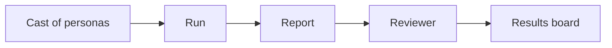

A persona is a fictional user with a role, goals, habits and a device.

A run signs one persona in to your app in Chrome or Firefox. The app is usually a preview built for one pull request. The persona tries to do its job and reports what broke, what confused it and what its role should not have seen. A reviewer checks each claim against screenshots, logs and code. Only claims with evidence reach the results board.





## What works today

The engine runs a persona in Chrome or Firefox and writes the run record, the persona's report and a screenshot for each step. It exports runs to Grafana (code: `internal/runner/runner.go` and `integrations/grafana/exporter/internal/cli/cli.go`). The model reviewer and the results board are planned (sourced: `docs/PLAN.md`). A person reviews findings with `dummyrun review` (code: `cmd/dummyrun/review.go`).

[Watch a real run](watch-a-run.md) of this website, step by step.

## Does it replace a scripted suite?

No. Keep your suite. A script checks the steps you wrote, the same way every time. A persona explores like a user and can find what nobody wrote a script for (inferred: the model picks its own actions, see `internal/runner/runner.go`). When a persona finds a problem you want guarded for good, write the test for it. [Beside your scripted suite](for/qa-lead.md) compares the two.

## Targets and models

An adapter finds the preview for a pull request, creates a test user with the right role and loads test data. The only adapter today takes a plain URL. Adapters for GitHub Deployments, Vercel, Netlify and Cloudflare Pages are planned. The adapter also says which hosts a run may touch.

The persona and the reviewer are two separate model roles. Providers are Azure OpenAI, Anthropic, Gemini and Amazon Bedrock. Gemini runs on Vertex AI or the Developer API. Any OpenAI-compatible service works too, including a local server (code: `internal/provider`). [The provider table](../../docs/PROVIDERS.md) shows what each one needs and can do. Vertex AI documents regional routing, so choose its region to keep runs inside a market (code: `docs/PROVIDERS.md`). The other providers have no market rule that the repository enforces.

## Evidence

A finding is a claim plus evidence. The reviewer rejects a claim unless a step in the run record supports it. That support is a screenshot, a console or network line, or a code reference. Each finding carries one of four tags.

| Tag | Meaning |
|---|---|
| measured | Seen in a run |
| code | Read in the source |
| sourced | Stated in an issue or document |
| inferred | Our reasoning, labelled as such |

Pending findings in schema version 2 records wait for a person to review them (code: `internal/review/store.go`). `dummyrun review` shows each pending finding with its steps and the paths of its screenshots (code: `cmd/dummyrun/review.go` and `internal/review/view.go`). A person confirms or rejects it, and the verdict goes into the run record with the reviewer's name and the time (code: `internal/review/store.go` and `internal/record/record.go`). A reason is optional when you confirm and required when you reject (code: `cmd/dummyrun/review.go`). `dummyrun review` records verdicts and never creates tickets (code: `cmd/dummyrun/review.go`). The board will use static HTML plus JSON built from run records (sourced: `docs/PLAN.md` and `docs/ARCHITECTURE.md`). A person decides what becomes a ticket (sourced: `README.md`).

## After review

No ticket is created automatically. A person reads the findings and decides what becomes a ticket. You can copy a finding into your tracker by hand, or write a script that reads the run record JSON.

## What leaves the network

Screenshots and page text go to the model provider you choose. The persona is a model that reads what the browser shows. Telemetry carries step URLs, control labels and finding titles. It carries no screenshots (code: `integrations/grafana/exporter/internal/telemetry/plan.go`). A title can quote a few words from the page. Telemetry goes only to the OpenTelemetry backend you configure. If you pass `--grafana-url`, Grafana also receives annotations. The telemetry lives wherever that backend lives. [Telemetry](../../docs/TELEMETRY.md) lists what it carries.

## Words we use

| Word | Meaning |
|---|---|
| Persona | A fictional user with a role, goals, habits and a device |
| Cast | A set of personas. The [persona library](personas.md) holds ready-made ones |
| Scenario | One job a persona tries to do |
| Preview | A copy of an app built for one pull request |
| Run | One persona working through one scenario against one preview |
| Run record | The JSON file a run writes, with its screenshots |
| Finding | A claim with evidence, confirmed or rejected by the reviewer |
| Results board | Static HTML and JSON listing the confirmed findings |

The crash-test theme calls the cast "dummies" and gives the project its [mascot](../../brand/README.md). The cautions about the name are in [How the name was chosen](../../docs/NAMING.md).
